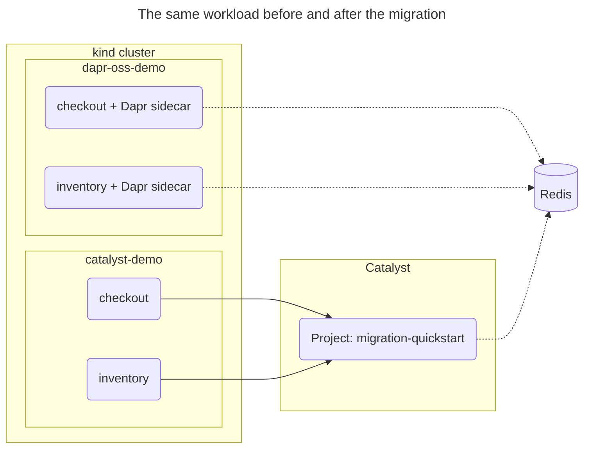

# Quickstart: Migrate from Dapr OSS to Catalyst

In this quickstart, you run a Go application on Dapr open source in a local Kubernetes cluster, then move it to [Catalyst](https://docs.diagrid.io/dapr-open-source/migrate-to-catalyst) with the Catalyst Kubernetes operator. You will learn how to:

- Check a Dapr OSS namespace for Catalyst compatibility.
- Install the Catalyst Kubernetes operator and migrate the namespace with one command.
- Confirm that service invocation, pub/sub, state, jobs, actors and workflows keep working on Catalyst.
- Cut over and remove Dapr OSS from the cluster.

The application has two roles built from one image:

- `checkout` saves an order to state, invokes `inventory`, publishes the order, schedules a job and starts a workflow.
- `inventory` serves the invocation and hosts the `StockActor` actor.



## 1. Prerequisites

- [Diagrid Catalyst account](https://catalyst.diagrid.io/)
- [Diagrid CLI](https://docs.diagrid.io/getting-started/install-cli) v1.105.0 or later
- [Docker](https://docs.docker.com/get-docker/), [kind](https://kind.sigs.k8s.io/docs/user/quick-start/#installation) and [kubectl](https://kubernetes.io/docs/tasks/tools/)
- [Dapr CLI](https://docs.dapr.io/getting-started/install-dapr-cli/)
- [Git](https://git-scm.com/downloads) and `envsubst` (part of GNU gettext)
- A Redis database reachable from the internet, with a password. A free [Redis Cloud](https://redis.io/try-free/) database works.

The Redis has to be reachable from the internet. After the migration the Dapr server runs in Catalyst, and Catalyst cannot resolve an address that exists only inside your cluster, such as `redis.default.svc.cluster.local`.

## 2. Log in to Catalyst

```bash
diagrid login
diagrid whoami
```

## 3. Clone the quickstart

```bash
git clone https://github.com/diagridio/catalyst-quickstarts.git
cd catalyst-quickstarts/migration
```

## 4. Run the application on Dapr OSS

Create the cluster and install Dapr:

```bash
kind create cluster --name migration-quickstart
dapr init -k --wait
```

Apply the Dapr resources with your Redis address and password:

```bash
export REDIS_HOST="<host>:<port>"
export REDIS_PASSWORD="<password>"
envsubst < k8s/components.yaml.tmpl | kubectl apply -f -
```

Build the image, load it into kind and deploy the two apps:

```bash
docker build -t migration-quickstart:local app
kind load docker-image migration-quickstart:local --name migration-quickstart
kubectl apply -f k8s/apps.yaml
kubectl -n dapr-oss-demo rollout status deploy/checkout deploy/inventory
```

In a second terminal, forward the `checkout` port:

```bash
kubectl -n dapr-oss-demo port-forward deploy/checkout 8080:8080
```

Back in the first terminal, send one order through the app:

```bash
curl -s localhost:8080/start
```

Read the logs:

```bash
kubectl -n dapr-oss-demo logs deploy/checkout -c checkout
kubectl -n dapr-oss-demo logs deploy/inventory -c inventory
```

`checkout` logs `STATE saved`, `INVOKE inventory/reserve`, `PUBSUB published`, `PUBSUB received`, `JOB scheduled restock`, `WORKFLOW started` and `ACTIVITY charged`. `JOB fired restock` follows a few seconds later. `inventory` logs `INVOKE reserve` and `ACTOR StockActor/widget`.

## 5. Check compatibility

```bash
diagrid k8s-operator compatibility dapr-oss-demo
```

The report lists the five resources that migrate, and none needs changes. It also asks for cert-manager, which you install in the next step.

## 6. Install the operator

The operator's webhook needs [cert-manager](https://cert-manager.io/) to issue its certificate:

```bash
kubectl apply -f https://github.com/cert-manager/cert-manager/releases/latest/download/cert-manager.yaml
kubectl wait --for=condition=Available -n cert-manager deploy --all --timeout=120s
diagrid k8s-operator install --wait
```

## 7. Migrate

Copy the namespace to `catalyst-demo` and register it in a new Catalyst project:

```bash
diagrid region list
diagrid k8s-operator migrate dapr-oss-demo \
  --new-namespace catalyst-demo \
  --project migration-quickstart \
  --region <region>
```

Let `migrate` create the project. Do not create `migration-quickstart` beforehand.

`--region` is needed only when your organization has more than one region. `diagrid region list` shows them.

## 8. Verify on Catalyst

Scale down the original Dapr OSS apps so only the migrated apps consume from Redis:

```bash
kubectl -n dapr-oss-demo scale deploy --all --replicas=0
kubectl -n catalyst-demo rollout status deploy/checkout deploy/inventory
```

`checkout` can restart once or twice while Catalyst accepts the state store. It runs once the store is ready.

In the second terminal, stop the port-forward from step 4 with `Ctrl+C` and forward the migrated `checkout` instead:

```bash
kubectl -n catalyst-demo port-forward deploy/checkout 8080:8080
```

Back in the first terminal, send another order and read the logs:

```bash
curl -s localhost:8080/start
kubectl -n catalyst-demo logs deploy/checkout -c checkout
kubectl -n catalyst-demo logs deploy/inventory -c inventory
```

You see the same log lines as in step 4. Open the `migration-quickstart` project in the [Catalyst web console](https://catalyst.diagrid.io/) to see the two App IDs, the components and the workflow run.

## 9. Cut over

Remove Dapr OSS from the cluster:

```bash
dapr uninstall -k
```

Send another order as in step 8 to confirm that the apps no longer depend on Dapr OSS.

## 10. Clean up

```bash
kind delete cluster --name migration-quickstart
diagrid project delete migration-quickstart
```

Deleting the `catalyst-demo` namespace while the operator runs also deletes the `migration-quickstart` project.

## Next steps

- [Use Catalyst with your existing Dapr setup](https://docs.diagrid.io/dapr-open-source/migrate-to-catalyst)
- [Migrate with the Catalyst Kubernetes operator](https://docs.diagrid.io/dapr-open-source/migrate-to-catalyst/kubernetes-operator)
- [Cut over and decommission Dapr OSS](https://docs.diagrid.io/dapr-open-source/migrate-to-catalyst/cut-over)
